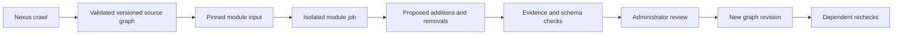

# Integration and admission plan

The intended deployment model is a reviewed module registry plus short-lived Dagster-managed jobs. A repository is the source of a module; an approved immutable container image is what runs. There is no need for a permanent service or a privileged account per bot.

## Admission

An operator reviews the source, license, ownership, declared sources, predicates, entity scope, tests and resource limits. Build and scan the image, run synthetic/adversarial fixtures, then run against a pinned real snapshot in proposal-only mode. Register the source commit and image digest only after evaluating the resulting changes. An updated commit/image repeats the gate. A registry entry can be disabled immediately without deleting its historical runs.

GitHub template repositories let contributors start independent repositories. CI tests proposed changes without production secrets; a pull request does not deploy a module. Dagster Pipes can launch external container processes and collect run metadata, while the JSON proposal contract remains language-independent.

## Runtime

The coordinator supplies a read-only input bundle and an output location. Use a dedicated namespace/service account, non-root user, read-only root filesystem, dropped capabilities, bounded CPU/memory/time and default-deny networking. Provider secrets belong to the source broker, not module code. Where direct external access is necessary, approve the exact destinations and quota. No pod receives Kubernetes administration, database passwords or a graph update token.

Modules run only after their prerequisites and source validation pass. A change event supplies exact source-version diffs and affected entity IDs. The coordinator follows dependency edges, deduplicates the same module/input revision, and orders rechecks. Accepted paper authorship/metadata changes recheck the affected people; conference discovery schedules series/edition enrichment. Changing ontology constraints invalidates proposals made against the previous revision.

## Validation and publication

The host authenticates the registered module, checks its capability scope, resolves evidence from immutable source versions, validates RDF/SHACL/ShEx and compares the submitted base graph with the current revision. Conflicting or stale work is rerun. Public bots cannot approve their own proposals. An administrator selects changes, examines their reasons and exact passages, and accepts or discards them through Observer's review mechanism.

Publication records the module/version/commit/image, run and model if applicable, source versions, exact passages, addition/removal reason, acceptance identity/time and new graph revision using PROV-O and the existing statement ledger. Removals preserve the original statement and record invalidation time and reason. Absence from a changed or unavailable page alone is insufficient grounds for deletion.

## Rollout stages

1. **Available:** public API/SPARQL/MCP reading; executable local module template; existing internal agent review and provenance machinery.
2. **Next:** contribution-import adapter and module registry. Translate validated bundles into the existing proposal queue; introduce narrowly scoped, revocable contribution credentials for approved external runners. Do not reuse administrator sessions.
3. **Then:** managed Dagster container executor, source broker, release admission checks and a Configuration UI for module scope, schedule, budgets and revocation.
4. **Later, if justified:** automatic acceptance for narrowly defined deterministic modules with measured precision, an explicit workspace policy and a rollback path. LLM-generated changes remain reviewable and never silently acquire this permission.

The registration and contribution API paths are intentionally not invented here: they will be documented in the platform OpenAPI specification when implemented.

References: [Dagster Kubernetes integration](https://dagster.io/integrations/dagster-kubernetes), [Dagster Pipes](https://dagster.io/blog/dagster-pipes), [GitHub template repositories](https://docs.github.com/en/repositories/creating-and-managing-repositories/creating-a-template-repository), [W3C PROV-O](https://www.w3.org/TR/prov-o/).
